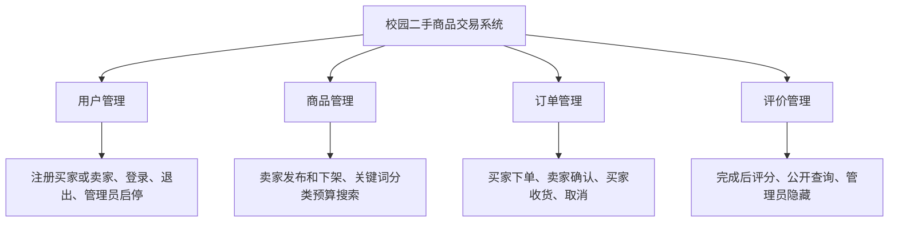
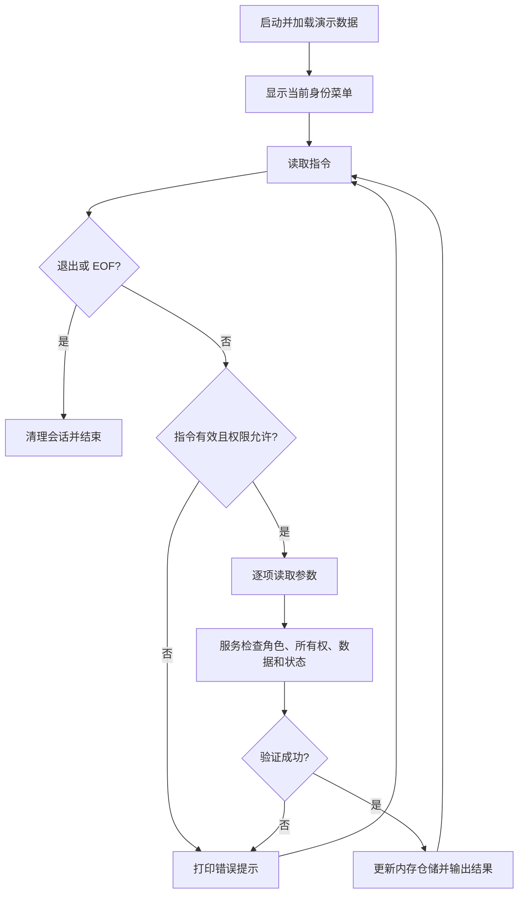
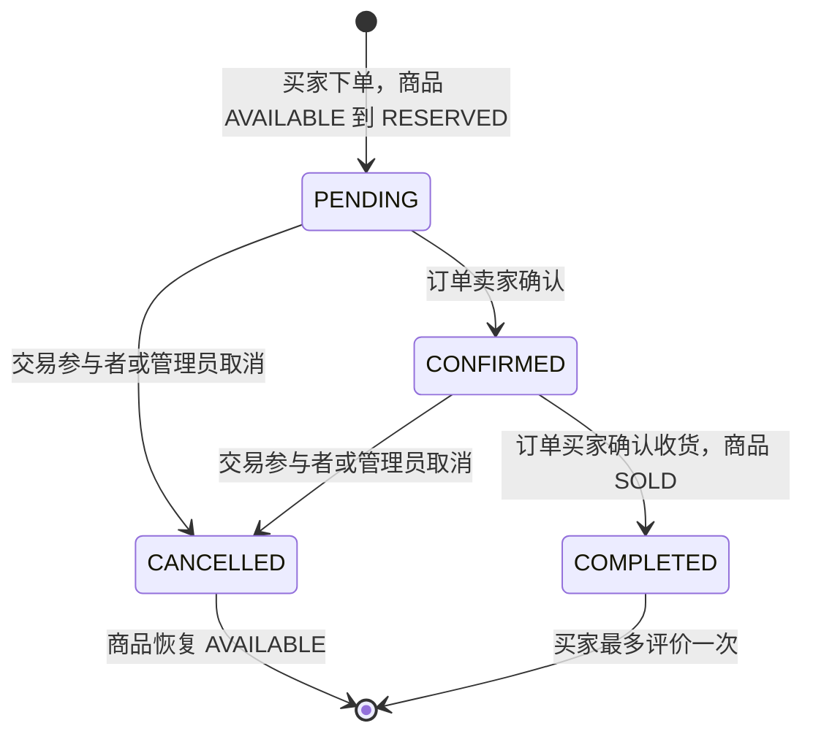
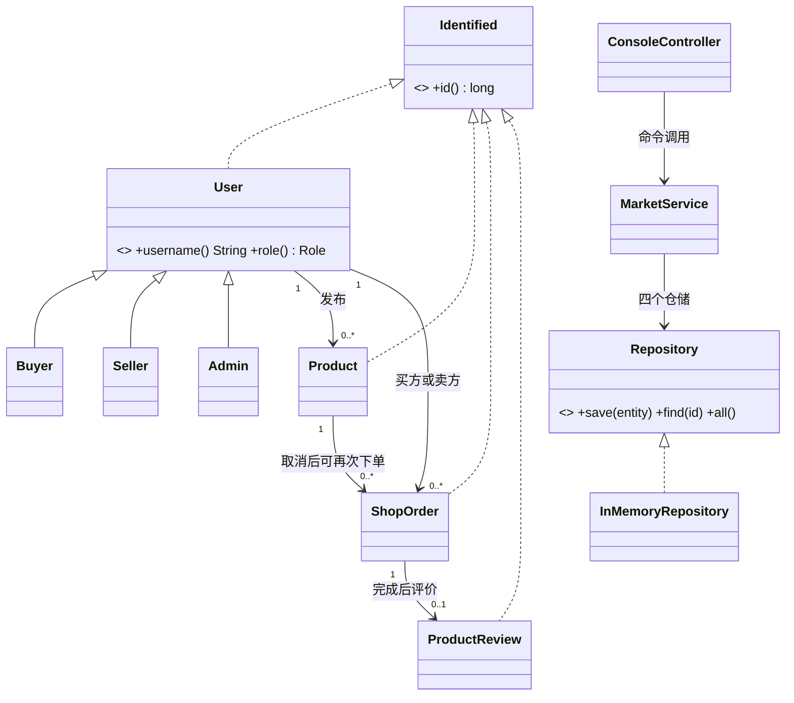

# 《Java 企业级应用》实验报告草稿

实验题目：基于命令行的校园二手商品交易管理系统。实验时间：2026 年 10 月 13 日。

姓名、学号及个人总结请由实验者补充。本文件记录实现设计和可复现验证，供填入原 Pages 模板；原模板中的个人信息及排版未改动。

## 一、实验目的

通过一个纯 Java 的校园交易程序练习构建与调试、封装继承多态、集合与泛型、注解与 Lambda、设计模式以及 AI 辅助编程结果的检查。系统满足命令行交互、不使用数据库、三类角色、四类实体与完整交易流程等要求。

## 二、实验项目内容与软件功能

以 AgentMall 原项目的商城领域和分层为基础，新增独立 `campus-cli` 模块。`User`、`Product`、`ShopOrder`、`ProductReview` 对应原项目领域，仓储使用内存集合替代 MyBatis Mapper，控制台替代 HTTP Controller，单件实物交易替代原购物车多商品订单。该方案满足实验约束，同时保留原商城模块。



三种角色分开注册与登录。买家负责购买和评价，卖家负责发布和确认，管理员负责治理。程序按当前角色展示菜单，服务层重复校验身份和所有权，以防只依赖界面隐藏造成越权。

## 三、特色与设计思想

1. 无数据库、无网络运行依赖。`LinkedHashMap` 保持记录顺序，`HashSet` 管理停用账号，Stream/Lambda 完成组合查询。重启恢复干净演示环境。
2. 商品与订单有明确状态机。商品被预订后暂时退出公开搜索，取消恢复可售，收货完成后锁定为售出，避免同一二手实物重复交易。
3. 不可变 record 防止通过实体引用任意修改业务状态。价格采用 `BigDecimal` 并保留订单快照；输入验证失败时不产生新业务记录。
4. 泛型仓储返回不可修改的列表副本；服务提供领域操作而非直接暴露仓储。具体持久化实现与业务对象分离。
5. `@AllowedRoles` 让权限菜单与命令入口使用同一元数据；错误输入提示后回到命令循环，EOF 在输入中途到来时不会发布半条商品。
6. 内存中保存带独立盐的 PBKDF2 密码派生值，会话使用随机 UUID。控制台密码输入当前会显示字符。

## 四、设计模式与语言元素

| 元素 | 实际实现 | 用途 |
| --- | --- | --- |
| 简单工厂 | `User.create` | 根据角色构建 Buyer、Seller、Admin 子类 |
| 继承、多态 | `User` 抽象类及三种子类的 `role()` | 菜单与服务无需分别调用不同用户类型 |
| Repository 模式 | `Repository<T>` / `InMemoryRepository<T>` | 将查询与保存隔离于领域服务 |
| Facade 模式 | `MarketService` | 对控制台统一提供交易与管理操作 |
| Command 模式 | `ConsoleController` 的 Command 注册表 | 将命令名映射到执行方法和帮助文字 |
| 注解、反射 | `AllowedRoles` / Method | 查询权限元数据并调用命令 |
| 泛型、接口 | `Repository<T extends Identified>` | 复用四类实体存储逻辑 |
| Lambda、Stream | `search` 等方法 | 筛选、排序、查询所有权、检查重复 |
| 内部类 | `User.Buyer/Seller/Admin`、`EndInput`、`Command` | 封装角色构建和控制台内部流程 |

## 五、程序结构和架构

```text
campus-cli/
  src/main/java/com/example/campus/
    CampusApplication.java      程序入口、对象组装
    controller/                 菜单、输入输出、命令分发
    service/                    身份、所有权、交易状态和验证
    repository/                 泛型接口、内存集合实现
    entity/                     用户、商品、订单、评价
    common/                     权限注解、业务异常、密码工具
  src/test/java/                无第三方依赖业务回归测试
  build.sh / test.sh / pom.xml  JDK 脚本和可选 Maven 构建
  docs/                         报告和实际验证记录
```

调用方向为 `CampusApplication → ConsoleController → MarketService → Repository`；实体由服务创建，仓储保存。无 JDBC、MyBatis、Spring 上下文或数据库连接。

## 六、程序主要执行流程





下架只允许商品处于 `AVAILABLE`；`RESERVED` 需先通过订单取消释放，已售出商品不可重新下架或再次购买。

## 七、类的说明与关系



`Product` 保存卖家、分类、成色、价格及商品状态；`ShopOrder` 保存买家、卖家、商品引用、价格名称快照和状态；`ProductReview` 保存订单与商品引用、买家、评分内容及隐藏标志。对象之间通过编号关联。

## 八、核心源码及说明

真实源码位于 `src/main/java/com/example/campus`。

泛型仓储：

```java
private final Map<Long, T> data = new LinkedHashMap<>();
public void save(T entity) { data.put(entity.id(), entity); }
public Optional<T> find(long id) { return Optional.ofNullable(data.get(id)); }
public List<T> all() { return List.copyOf(data.values()); }
```

Map 主键查找与保存的平均复杂度为 O(1)，全量筛选 O(n)，价格排序 O(n log n)。数据规模面向课程演示，不实现多线程交易并发。

下单的核心状态处理（完整权限和字段检查见 `MarketService.buy`）：

```java
check(product.status() == Product.Status.AVAILABLE, "商品已被预订、售出或下架");
ShopOrder order = new ShopOrder(++orderSequence, buyer.id(), product.sellerId(), product.id(),
        product.name(), product.price(), ShopOrder.Status.PENDING, LocalDateTime.now());
orders.save(order);
products.save(product.withStatus(Product.Status.RESERVED));
```

评价的关键前置条件（见 `MarketService.review`）：

```java
check(order.buyerId() == buyer.id(), "只能评价自己的订单");
check(order.status() == ShopOrder.Status.COMPLETED, "收货完成后才能评价");
check(rating >= 1 && rating <= 5, "评分须为 1–5");
check(reviews.all().stream().noneMatch(r -> r.orderId() == orderId), "该订单已评价");
```

## 九、人工智能应用情况

本次使用 Codex 对话助手辅助编程，用户提供 Java 实验文档，并要求基于自己的 AgentMall 脚手架实现。助手通过 GitHub 插件定位 `Renlair/AgentMall`，读取原商城领域和构建配置，解析 Pages 文件中的实验要求，再生成独立纯 Java 模块、中文菜单、业务回归测试和这份设计草稿。

关键取舍：原工程依赖数据库，不能直接用于无数据库命令行实验，因此沿用其包前缀、分层和领域命名，重新实现内存仓储及校园单件交易。用户追问数据保存位置后，明确选择运行期间内存集合、退出清空，不增加文件持久化。

AI 生成结果的验证包括 JDK 编译、完整角色切换交易、错误输入恢复、越权阻止、重复交易及评价阻止、取消恢复库存和停用账号检查。实际执行结果见验证记录。系统运行时没有调用大模型；AI 用于开发过程。实验者应阅读核心代码、复现运行并补充自己的理解和总结，不将自动生成草稿视为个人经历记录。

## 十、实验结果、调试分析与个人总结

运行与业务测试的实际结果记录在 [验证记录](验证记录.md)。测试必须观察期望异常及最终状态，而不是只验证某个方法被调用。重点案例为完整交易、越权、已预订重复购买、取消后重购、收货前评价、重复评价、管理员治理与命令行错误恢复。

设计中解决的问题：原商城 Mapper 依赖数据库，使用内存 Repository 解耦；金额浮点误差，使用 `BigDecimal`；商品重复出售，采用预订状态；跨用户操作，增加服务层所有权检查；中途输入 EOF，捕获内部结束信号后退出，不写入未验证的记录。

实验者个人总结待补充：实际运行时遇到的问题、如何理解继承与组合、对状态机和集合的认识，以及对 AI 生成代码所做的独立检查或修改。
