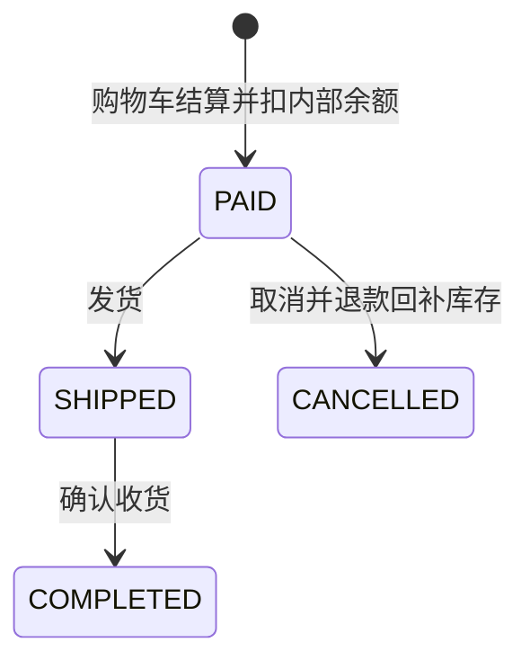
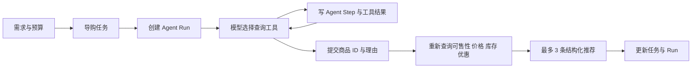
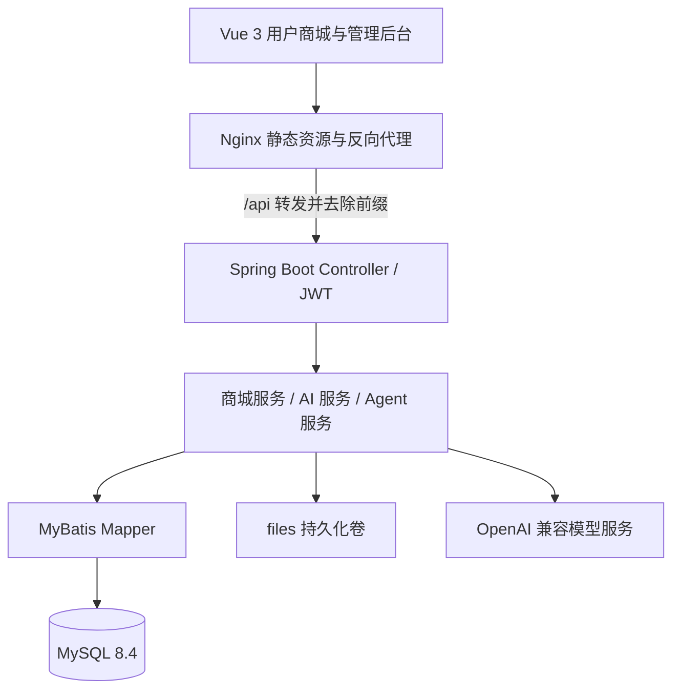

# AgentMall 开发高层设计

本文参照附件 DHD-v1.md 的“整体功能描述、前端职能、后端职能、接口定义”结构，根据 AgentMall 现有代码反向整理，供需求评审、维护开发、测试和交付使用。

编制日期：2026 年 10 月 17 日（America/Los_Angeles）。代码基线：`c483c42`；前端版本 `0.0.1`，后端版本 `0.0.1-SNAPSHOT`。

**口径说明**：“现状”表示源码中存在相应实现，不代表已完成运行验收；“目标/待完善”表示后续开发要求。本文未连接生产、未执行真实交易或调用收费模型。附件中的技术限制、团队和日期属于原项目示例，不作为 AgentMall 的事实或操作要求。

## 1. 整体功能描述

### 1.1 系统目标与用户角色

AgentMall 面向商品选购及商城运营，将商品、购物车、钱包和订单闭环与 AI 导购、商品知识问答、评价分析及增长建议结合。推荐理由和运行步骤可追溯至业务数据。

| 角色 | 业务职责 | 现状与目标边界 |
| --- | --- | --- |
| 普通用户 `USER` | 浏览商品、收藏、购物车、收货地址、钱包、订单、评价、智能导购及问答 | 注册接口固定创建 USER；个人数据隔离仍需服务端补齐 |
| 管理员 `ADMIN` | 商品交易管理、用户管理、售后规则、知识库、模型与工具配置、运行追踪 | 已有后台入口；JWT 拦截器仅验证身份，不能据此认定所有管理接口均做角色校验 |
| AI 导购 Agent | 调用查询工具并提交推荐商品及理由 | 是应用内执行流程，不是可独立登录的系统账号；无自动下单接口接入导购循环 |
| 部署维护人员 | 环境配置、备份、发布和恢复 | 属于运维职责，未实现为独立业务权限角色 |

目标权限矩阵：

| 功能域 | USER | ADMIN |
| --- | --- | --- |
| 商品、分类、品牌及展示内容 | 读取可售内容 | 管理 |
| 地址、收藏、购物车、钱包流水 | 仅本人 | 按管理职责授权，敏感字段脱敏 |
| 下单、取消、收货、评价 | 本人且符合状态约束 | 不代替用户执行个人行为，特殊处理另立规则 |
| 发货、评价审核、售后规则 | 不允许 | 允许 |
| 导购任务、问答及推荐 | 仅本人 | 管理查询 |
| 模型密钥、Prompt、工具配置、运行明细 | 不允许管理 | 管理，密钥响应脱敏 |

本矩阵是待完善的授权设计，不能作为当前服务端已经执行的保证。所有 userId 和对象 ID 均应与当前身份绑定校验，前端菜单显隐只负责交互。

### 1.2 核心业务对象

#### 1.2.1 用户与交易

- `user`：账号、角色、资料及余额；余额为商城内部账户金额。
- `user_address`：用户收货地址及默认标志。
- `product_favorite`、`shopping_cart`：用户与商品的收藏和购买意向；购物车包含数量和选中标记。
- `shop_order`：订单编号、用户、总额、数量、收货快照及状态时间。
- `shop_order_item`：订单商品名称、图片、价格和数量快照。
- `wallet_record`：充值、支付、收入、退款及退款支出流水。

现有下单即扣内部余额并进入 PAID；收款方由代码选择第一位管理员。没有外部支付渠道、支付回调或独立商户结算模型。充值接口直接增加余额，属于演示账本能力。

#### 1.2.2 商品与内容

- `product_category`、`product_brand`：分类和品牌。
- `product`：编号、名称、分类、品牌、图片、价格、库存、状态等基础信息。
- `product_detail`、`product_param`：商品详情和参数。
- `product_review`：订单明细关联评价，含评分、内容和审核状态。
- `after_sale_rule`：适用分类、场景、条件、处理流程、时限及启用标志。

售后模块是规则维护与查询，未形成退货申请、审核、寄回、退款的售后工单闭环。

#### 1.2.3 知识与模型

`product_knowledge → product_knowledge_chunk → product_knowledge_embedding` 构成知识到切片再到向量的处理链。向量以文本列存于 MySQL，在 Java 中计算余弦相似度；未使用独立向量数据库。

`ai_model_config` 保存 CHAT / EMBEDDING 模型及连接参数；`prompt_template`、`function_tool` 提供配置管理。导购运行使用代码中构造的工具 schema 和 switch 分派，不应把 Function Tool 表理解为已经支持任意动态工具执行。

#### 1.2.4 Agent 与分析结果

- `shopping_guide_task`：用户需求、预算、关联商品、执行结果及匹配商品 ID。
- `agent_run`：一次运行，关联任务、输入快照、输出、状态、耗时和错误。
- `agent_step`：运行中的有序工具步骤及最终推荐生成步骤。
- `shopping_recommendation`：任务、Run、用户、商品、价格和库存快照、排序、理由及证据。
- `shopping_qa`：问题类型、问题、回答、商品/订单关联及证据。
- `shopping_review_analysis`：商品评价分析结果。
- `shopping_growth_report`：业务指标快照和 AI 增长建议。

一个任务可多次执行并产生多个 Run；保存推荐按任务替换当前结果，不能假设历史推荐表保留所有版本。Run/Step 是执行记录，不等同于模型内部推理过程或完整业务审计日志。

### 1.3 状态与枚举

| 对象 | 值 | 含义与来源 |
| --- | --- | --- |
| 用户角色 | `USER` / `ADMIN` | 注册普通用户、后台管理员 |
| 商品可售状态 | `ON_SALE` | 下单及推荐实际检查的可售值；其他状态按页面和数据约定 |
| 订单 | `PAID` / `SHIPPED` / `COMPLETED` / `CANCELLED` | 已付款、已发货、已完成、已取消 |
| 导购任务 | `WAITING` / `DONE` / `FAILED` | 新建或修改后待执行；推荐落地成功/无有效推荐 |
| Agent Run / Step | `RUNNING` / `DONE` / `FAILED` | 运行中、成功、失败 |
| Run 类型 | `SHOPPING_GUIDE` | 当前记录的导购类型 |
| Step 类型 | `TOOL_CALL` / `RECOMMENDATION_GENERATE` | 工具调用、推荐生成 |
| 知识切片、向量 | `READY` | 可用于后续处理的状态 |
| 模型类型 | `CHAT` / `EMBEDDING` | 对话、向量 |
| 问答类型 | `PRODUCT` / `PRICE_STOCK` / `ORDER` / `AFTER_SALE` | 商品知识、价格库存、订单、售后 |
| 钱包流水 | `RECHARGE` / `PAY` / `INCOME` / `REFUND` / `REFUND_OUT` | 充值、支付、收入、退款、退款支出 |
| 评价新建状态 | `APPROVED` | 当前新评价默认通过审核，不是默认待审核 |
| 启用、选中标记 | `1` | 对应配置启用或购物车选中 |

导购异常捕获会将 Run 标记 FAILED，但未保证同步修改任务与正在运行的 Step；因此三类状态可能不一致，需在后续完善中统一收敛。

### 1.4 关键业务流程

#### 1.4.1 注册、登录与身份

1. 注册提交用户名及密码，后端创建 USER；未填密码时现有新增逻辑会使用默认密码，目标是改为强制有效密码。
2. 登录查询账号并直接比对数据库密码，生成有效期 1 天的 HMAC256 JWT；签名使用该用户数据库密码。
3. 前端将用户信息和 token 存入 localStorage 的 `sys-user`，请求头使用 `token`。
4. 拦截器读取 token（也支持查询参数），验证用户及签名；`/`、登录、注册和 `/files/**` 被排除。
5. 修改密码后旧 token 的签名校验会失败。当前无专用后端登出或 token 撤销接口。

目标：采用密码哈希、独立签名密钥、只返回必要用户字段，补齐角色与对象归属授权。该改造需要账号迁移及登录回归。

#### 1.4.2 浏览、购物车与下单

1. 用户按分类、品牌和关键字查询商品，查看详情、参数及评价。
2. 添加购物车并选中待购买项；设置收货信息。
3. 后端读取所选购物车项，检查可售状态、价格、数量及库存，使用 BigDecimal 汇总金额。
4. 在事务中扣用户余额、增加第一位管理员余额、写订单与商品快照、扣库存、清理已购买购物车项，并写双方流水。
5. 任一步抛出事务异常时回滚该次下单。当前库存实现为读取后写回，事务本身不能防止并发覆盖或超卖。

#### 1.4.3 订单履约、取消及评价



- 发货仅允许 PAID；确认收货仅允许 SHIPPED；取消仅允许 PAID。
- 取消在事务中扣管理员余额、退用户余额、回补库存并写退款流水；管理员余额不足时取消失败。
- 重复调用顺序场景会因状态不符被拒绝；并发调用还需要条件状态更新及幂等机制。
- 评价要求订单 COMPLETED、提交 userId 与订单用户相同、明细属于该订单及商品，且该明细尚未评价；评分 1～5。
- 上述 userId 比对并不等同于与 JWT 当前用户比对，仍需补对象归属授权。

#### 1.4.4 知识建设与问答

1. 管理员新增知识或从商品资料导入。
2. 对启用知识生成切片，固定长度 180 字符，重叠 30 字符；重建会删除对应旧切片和向量。
3. 有可用 EMBEDDING 配置时调用模型，否则使用 64 维本地 2-gram 哈希向量。
4. 全量向量生成由 CompletableFuture 后台执行，接口立即返回总数，页面轮询进度。同进程以 AtomicBoolean 阻止同时运行多个全量任务。
5. 检索按商品可选过滤、计算相似度，通用 topK 默认 5，范围限制为 1～20。
6. PRODUCT 问答固定取 top 3，再过滤相似度小于 0.5 的结果；无相关证据时直接说明资料未覆盖，不调用 CHAT。
7. 有证据时以检索上下文及问题调用 CHAT，保存回答及证据。其他问答类型通过价格库存、订单和售后规则业务查询生成回答。

本地哈希只能证明检索流程可用，不能作为语义检索效果验收。模型切换后需重建向量；目前仅记录模型名和维度，不足以保证混合向量空间安全隔离。

#### 1.4.5 智能导购



- Function Calling 对话循环最多 10 轮；工具包括候选搜索、价格、库存、优惠、用户画像及 `submit_recommendations`。
- 每次工具调用写 Step，并将工具结果回填对话。
- 推荐落地时再次检查商品 ON_SALE 和可购买库存，价格等快照来自真实业务工具。
- 无可落地结果时任务 FAILED；有结果时 DONE；预算筛选主要依赖候选搜索，最终落地未构成独立硬性预算保证。
- 当前执行接口同步等待 Agent，前端默认 30 秒超时，不能把页面超时等同于后端停止。需补执行幂等、并发保护和异步状态查询。

#### 1.4.6 评价分析与增长报告

评价分析只读取指定商品审核通过的评价，至少有一条才生成；好评为评分 ≥4、中评为 3、差评为 <3，均分与好评率由代码计算，优点、问题、关键词和优化建议由模型生成。重新生成会替换该商品原分析记录。增长报告由代码统计业务数据，再让模型撰写建议，数值不由模型自由计算。

现有增长指标口径：

| 指标 | 当前计算口径 |
| --- | --- |
| 订单数、销售额 | 全部订单中排除 CANCELLED；销售额汇总 totalAmount |
| 导购任务数、完成数 | 任务总数；状态为 DONE 的任务数 |
| 推荐数、问答数、评价分析数 | 对应表的当前记录数量 |
| conversionRate | 有效订单数 ÷ 导购任务数 × 100；分母为 0 时为 0 |

`reportType` 不能证明已按日/周过滤，当前生成逻辑读取全量数据；conversionRate 未关联“推荐导致订单”的归因事件，可能超过 100%，界面和文档应标注为数量比值，不能作为真实营销转化率。

### 1.5 当前实现边界与重点测试风险

| 编号 | 现状与影响 | 待完善目标 | 验证要点 |
| --- | --- | --- | --- |
| G-01 | JWT 有身份校验，管理权限及对象归属不完整 | ADMIN 管理授权；个人数据绑定当前用户 | USER 调后台、用户 A 访问 B 的订单/地址/钱包均拒绝 |
| G-02 | 密码直接比对、用户实体直接输出；模型配置含密钥 | 哈希迁移、响应 DTO、密钥脱敏 | 响应无密码、密钥；旧账号迁移后仍能登录 |
| G-03 | 库存读取后写回，状态变更缺并发条件 | 原子扣库存、条件状态流转、幂等键 | 并发不超卖、不重复退款，金额守恒 |
| G-04 | 充值增余额和流水缺统一事务 | 演示充值受控，写账和流水原子一致 | 流水失败时余额不变；不能给任意人充值 |
| G-05 | 导购异常只可靠标记 Run，长请求易超时 | Task/Run/Step 状态收敛和可查询执行 | 超时后可追踪；重复执行不产生冲突结果 |
| G-06 | 向量进度仅内存保存；单实例锁 | 明确重启恢复策略和任务范围互斥 | 进程重启、单条与全量同时重建的行为 |
| G-07 | 向量按应用扫描，模型切换缺空间隔离 | 限制数据规模，校验模型版本并支持重建 | 相同维度不同模型也不能混用 |
| G-08 | Markdown 直接 marked.parse；文件接口免鉴权 | HTML 清洗、文件类型/大小与路径校验 | 恶意标签、危险链接、越界路径、超限文件 |
| G-09 | 报告类型与时间范围不绑定；归因不完整 | 展示真实指标口径，后续再增加归因和日期参数 | 零分母、取消订单、数量比值超过 100% |
| G-10 | README 声称缺 SQL/容器/测试，与代码冲突 | 以 deploy 和源码为准同步说明 | 新环境依初始化脚本可复现；测试覆盖准确描述 |

### 1.6 总体架构、数据和部署



技术基线：Vue 3、Vite 5、Vue Router 4、Element Plus、Axios、Marked；Java 21、Spring Boot 3.5.14、Spring AI 1.1.7、MyBatis、PageHelper、JWT。Node.js 使用 20 或更高并满足锁文件要求。确切依赖以 pom.xml、package.json 和 lock 为准。

数据库有 27 张初始化表，见附录 B。关联由主键及业务 ID 表达，不应把逻辑关系一概视为数据库外键保护。后续迁移需分别审查唯一性、索引、精度、默认值及删除影响。

部署现状：`deploy/` 已提供前后端 Dockerfile、Compose、MySQL 初始化 SQL、测试数据引导、Nginx、验证脚本和 CI 接收器。首次空库初始化与既有数据库升级是两条流程；现有 CI 不自动执行迁移。

前端容器构建使用 `/api`，Nginx 代理至后端 9090；`/files/` 保留路径转发；History 路由回退 index.html。MySQL 与上传文件分别使用命名卷。默认 Web 仅绑定 127.0.0.1:8080，公网与 HTTPS 需按部署配置另行设置。应用镜像可回滚，数据结构需要单独恢复策略。

## 2. 前端职能

### 2.1 前端总体职责

- 以 Vue Router History 组织 `/front` 用户商城及 `/manager` 后台，支持登录、注册和 404。
- 封装 API 基址、token、网络及业务错误提示；以字符串 `code === '200'` 判断业务成功。
- 表单校验、分页筛选、确认操作、提交中状态和空结果展示。
- 展示 AI 推荐理由、证据与运行记录；AI 文本渲染须增加 HTML 清洗。
- 对余额、库存、订单状态以服务端结果为准；购买后刷新购物车、余额及订单。
- 提供路由和角色体验控制，同时由后端承担真实授权。

### 2.2 页面与职责

#### 2.2.1 登录与注册

| 路径 | 职责 | 测试重点 |
| --- | --- | --- |
| `/login` | 账号密码登录，按角色进入商城或后台 | 必填、回车提交、错误提示、过期 token、移动端布局 |
| `/register` | 普通账号注册并返回登录 | 重名、空密码、禁止通过请求体自行注册 ADMIN |

#### 2.2.2 用户商城

| 路径 | 职责 | 测试重点 |
| --- | --- | --- |
| `/front/home` | 分类、品牌、搜索、商品列表 | 组合条件、空结果、可售过滤 |
| `/front/product/:id` | 商品详情、参数、评价、收藏、加购及问答 | 无效 ID、无库存、图片缺失、证据展示 |
| `/front/guide` | 提交需求和预算、展示推荐 | 提交中、模型失败、超时后刷新、无结果 |
| `/front/favorite` | 查询与移除本人收藏 | 重复收藏、失效商品、归属 |
| `/front/cart` | 数量、选中、移除、结算 | 数量上下界、余额不足、价格及库存变化 |
| `/front/order` | 订单明细、取消、收货及评价 | 每种状态动作、重复提交、退款后刷新 |
| `/front/wallet` | 余额、演示充值和流水 | 金额输入、充值失败、余额与流水一致 |
| `/front/person` | 资料及收货地址管理 | 默认地址、删除、跨用户 ID |
| `/front/password` | 修改密码 | 原密码错误、新密码合法性、旧 token 失效 |

#### 2.2.3 管理后台

以下均以 `/manager/` 为前缀。

| 路由 | 页面职责 | 主要依赖 |
| --- | --- | --- |
| `home` | 后台概览和功能入口 | 商城基础数据 |
| `user` | 用户查询及维护 | user |
| `productCategory`、`productBrand` | 分类、品牌维护 | 基础字典 |
| `product` | 商品价格、库存、上下架及推荐标志 | product |
| `productDetail` | 商品详情、参数维护 | productDetail / productParam |
| `shopOrder` | 订单查询、发货 | shopOrder |
| `productReview`、`afterSaleRule` | 评价审核、售后规则维护 | productReview / afterSaleRule |
| `productKnowledge` | 知识维护、商品导入 | productKnowledge |
| `productKnowledgeChunk` | 单条和全量切片、删除 | productKnowledgeChunk |
| `productKnowledgeEmbedding` | 向量生成、进度、检索 | embedding |
| `aiModelConfig` | 模型类型、连接、启用配置 | 模型配置接口，密钥需脱敏 |
| `promptTemplate`、`functionTool` | Prompt 与工具元数据 | 配置管理 |
| `productToolDebug`、`businessToolDebug` | 商品及业务工具调试 | productTool / businessTool |
| `shoppingGuideTask` | 需求维护、执行及结果 | task |
| `agentRun`、`agentStep` | 运行、步骤、耗时及错误查询 | Run / Step |
| `shoppingRecommendation`、`shoppingQa` | 推荐与问答结果管理 | 结果记录 |
| `shoppingReviewAnalysis`、`shoppingGrowthReport` | 生成评价分析、增长报告 | 分析生成接口 |
| `person`、`password` | 管理员资料和密码 | user |

### 2.3 前端测试输入原则

覆盖未登录、USER、ADMIN 和第二名 USER；直接访问路由及手工改请求 ID；金额和数量边界；空列表与分页；AI 输出长文本、HTML、代码围栏、空结果；30 秒超时与重试；桌面/手机布局。响应成功但业务 code 非 200 的场景必须正确反馈。

## 3. 后端职能

### 3.1 HTTP 与身份层

Controller 接收 JSON、查询参数、路径参数或 multipart；Service 承担业务，Mapper 执行 SQL，Result 统一业务响应，GlobalExceptionHandler 转换异常。

JWT 只说明请求主体身份。目标是在 Controller/Service 入口统一验证管理角色，并对每个用户对象执行归属校验。用户身份从 token 解析，不信任客户端提供 userId。当前 CORS、文件公开范围及查询参数 token 需专项评估后收紧。

### 3.2 商品与用户模块

维护分类、品牌、商品、详情和参数；维护用户资料、收货地址和收藏。目标校验价格非负、库存非负、状态合法、关联对象存在；限制用户可修改字段，禁止通过资料更新改变 role、balance、password 等敏感字段。

### 3.3 交易与钱包模块

订单创建和取消已有事务；后续补充原子扣库存、状态条件更新、订单号碰撞处理、结算幂等、充值事务、金额精度和账本对账。核心不变量：库存不小于 0；订单实付与商品快照合计一致；双方转账与流水一致；同一订单最多一次有效取消退款。

### 3.4 评价与售后规则模块

评价服务校验已完成订单、用户、明细、商品关联及重复评价，支持后台审核。目标补当前身份、审核枚举约束及并发唯一性。售后规则按启用、分类和场景查询，不承担自动退款执行。

### 3.5 知识库与检索模块

商品导入、知识 CRUD、重建切片、向量生成和相似度检索分层实现。目标在模型版本切换时执行一致性重建，并禁止混合空间检索；全量进度持久化或明确限定单实例演示及重启后人工重跑。重建失败不能被展示为完整成功。

### 3.6 AI 模型与工具模块

AiChatService 读取数据库启用配置；普通对话及 embedding 通过 SpringAiModelFactory 动态创建 Spring AI 模型；Agent Function Calling 用 HTTP 调用兼容聊天接口。相同类型当前取第一条启用配置，目标控制唯一有效配置或明确选择优先级。

工具只从允许列表执行；模型输出属于不可信输入，要验证名称、JSON 参数、商品 ID、数量、预算和结果集合。不得由模型文本直接修改余额或订单状态。Prompt/工具管理与运行时接线变化需要测试证明，不能仅凭配置保存成功判定生效。

### 3.7 Agent 与分析模块

任务和运行过程分别落库，推荐由模型选择、业务工具复核。目标增加相同任务并发互斥、异常时 Task/Run/Step 状态收敛、推荐去重、预算硬约束及运行版本快照。步骤只记录实际业务输入输出和必要错误。

评价分析和增长建议保存为可追溯结果；统计字段由代码确定，生成文字不可改写统计事实。目标对模型失败、非法 JSON、限流、上下文超限和空输出提供明确失败反馈。

### 3.8 数据一致性与事务

| 操作 | 当前实现 | 后续处理要求 |
| --- | --- | --- |
| 下单、取消 | `@Transactional` | 保留事务，增加原子库存和状态条件，避免双花/重复退款 |
| 充值 | 多次写库，无方法事务 | 余额和流水共同提交，失败共同回滚 |
| 重新切片 | 先删向量与切片再插入 | 明确事务或版本切换，避免半成品可读 |
| 全量向量生成 | 后台逐条删除再生成 | 失败统计、可重试、版本隔离与任务互斥 |
| 导购与推荐替换 | 多步服务调用 | 结果发布具原子性，运行记录可独立保存失败 |
| Run 删除 | 先删 Step 再删 Run | 补事务、权限及保留策略，避免误删追溯依据 |

## 4. 接口定义

### 4.1 通用协议

#### 4.1.1 请求

后端原生路径不含 `/api`，例如 `/user/login`。容器 Web 访问路径为 `/api/user/login`，由 Nginx 去掉 `/api` 再转发。开发环境可直接访问 `http://localhost:9090`。

- GET：查询参数与路径参数；POST/PUT：通常为 JSON；DELETE 批量：JSON ID 数组。
- 文件上传：multipart/form-data，字段 `file`。
- 身份请求头：`token: <JWT>`；不使用模板项目的 Cookie 会话或全 POST 协议。
- 分页：`pageNum=1&pageSize=10`，返回 PageHelper 的 PageInfo，常用 `list/total/pageNum/pageSize/pages`。
- 默认前端超时 30000ms；Nginx proxy_read_timeout 为 180s；需一起评审长任务体验。

#### 4.1.2 成功与错误响应

```json
{"code":"200","msg":"请求成功","data":{"id":1}}
```

```json
{"code":"400","msg":"参数异常","data":null}
```

异常处理返回 Result，没有通过 ResponseEntity 显式设置业务异常 HTTP 状态；因此不能把业务 code 与 HTTP 状态等同。网络层状态错误与业务 Result 错误分别处理。

| 业务 code | 含义 |
| --- | --- |
| `200` | 成功 |
| `400` / `4001` | 参数异常 / 参数缺失 |
| `401` | token 缺失或验证失败 |
| `500` | 系统、模型等错误，具体看 msg |
| `5001` / `5002` / `5003` | 用户已存在 / 未登录 / 账号密码错误 |
| `5004` / `5005` | 用户不存在 / 原密码错误 |
| `5006` | 已有全量向量生成任务执行中 |

部分服务直接复用业务编码：评价分析的 `5001` 表示商品不存在，`5002` 表示无已审核评价。前端需结合接口和 msg，不能把所有 `5001/5002` 均解释为账号问题；后续应规范错误码命名空间。

### 4.2 认证与用户接口

| 接口 | 请求与成功数据 | 关键断言 |
| --- | --- | --- |
| `POST /user/register` | username、password；无业务 data | 强制 USER，重复用户名 5001；空密码默认行为需整改 |
| `POST /user/login` | username、password；用户对象及 token | 错用户 5004、错密码 5003；目标响应排除 password |
| `PUT /user/updatePassword` | username、password、newPassword | 原密码错误 5005；目标只能修改本人 |
| `GET /user/selectById/{id}` | 用户对象 | 目标仅本人/授权管理员，不泄露密码 |
| `GET /user/selectAll`、`GET /user/selectPage` | User 查询字段、分页 | 目标 ADMIN，响应字段白名单 |
| `POST /user/add`、`PUT /user/update`、删除接口 | User 或 ID | 管理与个人资料更新需区分字段权限 |

当前未发现专用业务健康检查 Controller；CI 使用页面及不存在账号登录返回 5004 检查 SQL 路径，不能写成已有 `/health` 接口。

### 4.3 商品、字典与内容接口

`productCategory`、`productBrand`、`product` 有 add、update、单删、批删、selectAll、selectPage；`afterSaleRule`、`aiModelConfig`、`promptTemplate`、`functionTool` 有同样写接口与 selectPage，没有统一的 selectAll 端点。确切方法见附录 A。

| 接口 | 输入 | 成功数据与规则 |
| --- | --- | --- |
| `GET /product/selectPage` | 商品筛选与分页 | PageInfo 商品列表 |
| `POST /productDetail/save` | ProductDetail | 保存详情，无业务 data |
| `GET /productDetail/selectByProductId/{productId}` | 商品 ID | 详情对象 |
| `POST /productParam/add`、`PUT /productParam/update` | ProductParam | 商品参数维护 |
| `GET /productParam/selectAll` | 参数查询字段 | 参数数组 |
| `POST /productReview/add` | userId、orderId、orderItemId、productId、rating、content | 已完成订单、评分 1～5、未重复 |
| `PUT /productReview/audit` | id、auditStatus | 审核更新，目标 ADMIN 与合法状态 |
| `GET /productReview/selectAll`、`GET /productReview/selectPage` | 筛选与分页 | 评价列表/分页 |

### 4.4 收藏、地址、购物车与钱包接口

| 接口 | 输入 | 成功数据/检查点 |
| --- | --- | --- |
| `POST /productFavorite/add` | userId、productId 等实体字段 | 收藏添加，检查重复策略 |
| `DELETE /productFavorite/delete/{id}` | 收藏 ID | 目标校验本人 |
| `GET /productFavorite/selectAll` | userId 等筛选 | 收藏列表 |
| `POST /shoppingCart/add`、`PUT /shoppingCart/update` | userId、productId、quantity、selected 等 | 数量、选中与商品可售性 |
| `GET /shoppingCart/selectAll` | userId 等 | 含商品价格、库存的列表 |
| `DELETE /shoppingCart/delete/{id}`、`DELETE /shoppingCart/delete/batch` | ID / ID 数组 | 目标全量校验归属 |
| `POST /userAddress/add`、`PUT /userAddress/update` | 地址实体 | 地址维护 |
| `GET /userAddress/selectByUserId/{userId}` | 用户 ID | 地址列表 |
| `PUT /userAddress/setDefault/{id}/{userId}` | 地址和用户 ID | 默认地址切换，目标校验二者关联 |
| `DELETE /userAddress/delete/{id}` | 地址 ID | 删除 |
| `POST /wallet/recharge` | userId、amount、可选 remark | amount > 0，返回更新后的 User；目标受控演示充值及 DTO |
| `GET /wallet/records/{userId}` | 用户 ID | 钱包流水 |

以上传入 userId 是现有协议描述，后续授权整改应优先从当前身份取值。

### 4.5 订单接口与状态测试

| 接口 | 输入 | 成功数据/关键规则 |
| --- | --- | --- |
| `POST /shopOrder/create` | userId、receiverName、receiverPhone、receiverAddress | 返回含 items 的订单；结算该用户已选购物车项 |
| `PUT /shopOrder/ship/{id}` | 订单 ID | 无业务 data；仅 PAID 可发货 |
| `PUT /shopOrder/finish/{id}` | 订单 ID | 无业务 data；仅 SHIPPED 可完成 |
| `PUT /shopOrder/cancel/{id}` | 订单 ID | 无业务 data；仅 PAID 可取消并退款 |
| `GET /shopOrder/selectAll`、`GET /shopOrder/selectPage` | 订单筛选与分页 | 含订单明细的列表/分页 |

创建请求示例（ID 均为测试数据占位）：

```json
{"userId":2,"receiverName":"测试用户","receiverPhone":"13800000000","receiverAddress":"测试收货地址"}
```

| 原状态 | 发货 | 完成 | 取消 |
| --- | --- | --- | --- |
| PAID | 允许 | 拒绝 | 允许 |
| SHIPPED | 拒绝 | 允许 | 拒绝 |
| COMPLETED | 拒绝 | 拒绝 | 拒绝 |
| CANCELLED | 拒绝 | 拒绝 | 拒绝 |

补测：购物车无选中项、数量为 0/负数、余额恰好足够/差一分、库存恰好足够/不足、管理员不存在或退款余额不足、重复下单、并发最后一件商品、并发取消、明细写失败回滚。

### 4.6 知识与向量接口

| 接口 | 输入 | 成功数据与断言 |
| --- | --- | --- |
| `POST /productKnowledge/add`、`PUT /productKnowledge/update` | 知识实体 | 管理内容及启用状态 |
| `POST /productKnowledge/importFromProduct/{productId}`、`POST /productKnowledge/importAll` | 商品 ID / 无 | 从商品构建知识，检查重复和覆盖行为 |
| `POST /productKnowledgeChunk/generate/{knowledgeId}` | 知识 ID | 生成数量；旧切片和向量失效 |
| `POST /productKnowledgeChunk/generateAll` | 无 | 启用知识的生成数量 |
| `POST /productKnowledgeEmbedding/generate/{chunkId}` | 切片 ID | 生成数量 |
| `POST /productKnowledgeEmbedding/generateAll` | 无 | 启动后台任务，返回待处理总数 |
| `GET /productKnowledgeEmbedding/generateProgress` | 无 | 进度对象；运行、总数、成功/失败等 |
| `POST /productKnowledgeEmbedding/search` | queryText、可选 topK、productId | 相似度降序结果；topK 限制 1～20 |

```json
{"queryText":"续航时间多久","topK":3,"productId":1}
```

列表与删除方法见附录 A。测试空知识、停用知识、空问题、topK 越界、真实向量失败、本地回退、重建中查询、重复全量任务及重启后进度。

### 4.7 导购、推荐与运行接口

| 接口 | 输入 | 成功数据与断言 |
| --- | --- | --- |
| `POST /shoppingGuideTask/add` | demandText；可选 userId、budgetAmount、productId | 新任务对象，初始 WAITING |
| `PUT /shoppingGuideTask/update` | 带 id 的任务字段 | 重置 WAITING，后续应限制可修改字段 |
| `POST /shoppingGuideTask/execute/{id}` | 任务 ID | 执行后任务；同步调用 |
| `GET /shoppingGuideTask/selectAll`、`GET /shoppingGuideTask/selectPage` | 任务筛选 | 列表/分页 |
| `GET /shoppingRecommendation/selectAll`、`GET /shoppingRecommendation/selectPage` | taskId、runId、userId 等实体筛选 | 推荐及价格、库存、理由、证据快照 |
| `GET /agentRun/selectPage` | 运行筛选与分页 | 状态、输入输出及错误 |
| `GET /agentStep/selectPage` | runId 等与分页 | 步骤输入输出、顺序、状态及耗时 |

```json
{"userId":2,"demandText":"通勤用无线耳机，重视降噪和续航","budgetAmount":500}
```

运行时工具清单：

| 工具名 | 用途 |
| --- | --- |
| `search_candidate_products` | 按需求和预算找候选 |
| `query_product_price` | 查询价格 |
| `query_product_stock` | 查询库存和可购买性 |
| `query_product_promotion` | 查询优惠 |
| `query_user_profile` | 查询用户业务画像 |
| `submit_recommendations` | 提交商品 ID 与理由，服务端再复核 |

以上是模型工具名，不是 HTTP URL。HTTP 调试入口为 `POST /productTool/price`、`/stock`、`/promotion` 和 `POST /businessTool/userProfile`、`/similarProducts`、`/orderStatus`。商品工具请求含 productId / productNo / productName、可选 quantity；业务工具含用户、商品、订单定位字段及可选 limit，按具体工具取用。

导购重点断言：模型不支持工具、非法 JSON/未知工具、无候选、候选下架/缺货、重复商品 ID、预算不符、10 轮结束未提交、模型抛错、重复执行、结果替换、Run/Step 可追溯。

### 4.8 问答、评价分析与增长报告接口

| 接口 | 请求 | 成功数据与关键规则 |
| --- | --- | --- |
| `POST /shoppingQa/ask` | questionType、questionText；可选 userId、商品和订单定位字段 | ShoppingQa；PRODUCT/PRICE_STOCK 需商品 ID 或名称，ORDER 需订单 ID 或编号 |
| `GET /shoppingQa/selectPage` | 问答筛选与分页 | 问答及证据 |
| `POST /shoppingReviewAnalysis/generate` | productId | 商品评价分析结果 |
| `GET /shoppingReviewAnalysis/selectPage` | 分析筛选与分页 | 分析记录 |
| `POST /shoppingGrowthReport/generate` | 可选 reportTitle、reportType | 全量业务指标及建议快照，默认 OVERALL |
| `GET /shoppingGrowthReport/selectPage` | 报告筛选与分页 | 报告记录 |

```json
{"userId":2,"questionType":"PRODUCT","questionText":"支持主动降噪吗","productId":1}
```

重点断言：0.5 相似度边界、无证据不调用模型、跨商品资料不混入、订单归属、售后规则停用、无评价、非法模型 JSON、零订单/零任务、取消订单排除、模型建议不篡改数字。

### 4.9 文件、部署验证与接口验收

`POST /files/upload` 使用 multipart 字段 file，返回文件访问地址；`GET /files/download/{fileName}` 返回文件字节流。当前两者均在 JWT 排除范围内；默认文件路径与 Java 进程工作目录有关，容器持久化于 `/app/files`。

现有 `deploy/verify.py` 检查登录页面、管理员登录、商品查询、上传下载及重启后文件校验；需要部署 `.env` 和可运行环境，且会写测试文件。`deploy/ci/test_receiver.py` 是部署接收器测试，不等同于商城/AI 业务测试。当前未发现 `springboot/src/test`，前端 package.json 未提供 test 脚本。

接口验收应以附录 A 为路由清单逐项登记正常、参数错误、未登录、低权限、越权和状态不符结果；本文件仅完成静态反向核对，不声称这些验收已通过。

## 附录 A. 当前 HTTP 路由清单

以下由当前 Controller 注解提取，路径为后端原生路径。CRUD 请求体对应同名实体；响应除文件下载外均封装 Result。权限列在实际执行验收时按第 1.1 节目标矩阵补充。

| Controller | HTTP | 原生路径 |
| --- | --- | --- |
| AfterSaleRuleController | POST | `/afterSaleRule/add` |
| AfterSaleRuleController | PUT | `/afterSaleRule/update` |
| AfterSaleRuleController | DELETE | `/afterSaleRule/delete/{id}` |
| AfterSaleRuleController | DELETE | `/afterSaleRule/delete/batch` |
| AfterSaleRuleController | GET | `/afterSaleRule/selectPage` |
| AgentRunController | DELETE | `/agentRun/delete/{id}` |
| AgentRunController | DELETE | `/agentRun/delete/batch` |
| AgentRunController | GET | `/agentRun/selectPage` |
| AgentStepController | DELETE | `/agentStep/delete/{id}` |
| AgentStepController | DELETE | `/agentStep/delete/batch` |
| AgentStepController | GET | `/agentStep/selectPage` |
| AiModelConfigController | POST | `/aiModelConfig/add` |
| AiModelConfigController | PUT | `/aiModelConfig/update` |
| AiModelConfigController | DELETE | `/aiModelConfig/delete/{id}` |
| AiModelConfigController | DELETE | `/aiModelConfig/delete/batch` |
| AiModelConfigController | GET | `/aiModelConfig/selectPage` |
| BusinessToolController | POST | `/businessTool/userProfile` |
| BusinessToolController | POST | `/businessTool/similarProducts` |
| BusinessToolController | POST | `/businessTool/orderStatus` |
| FileController | POST | `/files/upload` |
| FileController | GET | `/files/download/{fileName}` |
| FunctionToolController | POST | `/functionTool/add` |
| FunctionToolController | PUT | `/functionTool/update` |
| FunctionToolController | DELETE | `/functionTool/delete/{id}` |
| FunctionToolController | DELETE | `/functionTool/delete/batch` |
| FunctionToolController | GET | `/functionTool/selectPage` |
| ProductBrandController | POST | `/productBrand/add` |
| ProductBrandController | PUT | `/productBrand/update` |
| ProductBrandController | DELETE | `/productBrand/delete/{id}` |
| ProductBrandController | DELETE | `/productBrand/delete/batch` |
| ProductBrandController | GET | `/productBrand/selectAll` |
| ProductBrandController | GET | `/productBrand/selectPage` |
| ProductCategoryController | POST | `/productCategory/add` |
| ProductCategoryController | PUT | `/productCategory/update` |
| ProductCategoryController | DELETE | `/productCategory/delete/{id}` |
| ProductCategoryController | DELETE | `/productCategory/delete/batch` |
| ProductCategoryController | GET | `/productCategory/selectAll` |
| ProductCategoryController | GET | `/productCategory/selectPage` |
| ProductController | POST | `/product/add` |
| ProductController | PUT | `/product/update` |
| ProductController | DELETE | `/product/delete/{id}` |
| ProductController | DELETE | `/product/delete/batch` |
| ProductController | GET | `/product/selectAll` |
| ProductController | GET | `/product/selectPage` |
| ProductDetailController | POST | `/productDetail/save` |
| ProductDetailController | GET | `/productDetail/selectByProductId/{productId}` |
| ProductFavoriteController | POST | `/productFavorite/add` |
| ProductFavoriteController | DELETE | `/productFavorite/delete/{id}` |
| ProductFavoriteController | GET | `/productFavorite/selectAll` |
| ProductKnowledgeChunkController | POST | `/productKnowledgeChunk/generate/{knowledgeId}` |
| ProductKnowledgeChunkController | POST | `/productKnowledgeChunk/generateAll` |
| ProductKnowledgeChunkController | DELETE | `/productKnowledgeChunk/delete/{id}` |
| ProductKnowledgeChunkController | DELETE | `/productKnowledgeChunk/delete/batch` |
| ProductKnowledgeChunkController | GET | `/productKnowledgeChunk/selectAll` |
| ProductKnowledgeChunkController | GET | `/productKnowledgeChunk/selectPage` |
| ProductKnowledgeController | POST | `/productKnowledge/add` |
| ProductKnowledgeController | POST | `/productKnowledge/importFromProduct/{productId}` |
| ProductKnowledgeController | POST | `/productKnowledge/importAll` |
| ProductKnowledgeController | PUT | `/productKnowledge/update` |
| ProductKnowledgeController | DELETE | `/productKnowledge/delete/{id}` |
| ProductKnowledgeController | DELETE | `/productKnowledge/delete/batch` |
| ProductKnowledgeController | GET | `/productKnowledge/selectAll` |
| ProductKnowledgeController | GET | `/productKnowledge/selectPage` |
| ProductKnowledgeEmbeddingController | POST | `/productKnowledgeEmbedding/generate/{chunkId}` |
| ProductKnowledgeEmbeddingController | POST | `/productKnowledgeEmbedding/generateAll` |
| ProductKnowledgeEmbeddingController | GET | `/productKnowledgeEmbedding/generateProgress` |
| ProductKnowledgeEmbeddingController | POST | `/productKnowledgeEmbedding/search` |
| ProductKnowledgeEmbeddingController | DELETE | `/productKnowledgeEmbedding/delete/{id}` |
| ProductKnowledgeEmbeddingController | DELETE | `/productKnowledgeEmbedding/delete/batch` |
| ProductKnowledgeEmbeddingController | GET | `/productKnowledgeEmbedding/selectPage` |
| ProductParamController | POST | `/productParam/add` |
| ProductParamController | PUT | `/productParam/update` |
| ProductParamController | DELETE | `/productParam/delete/{id}` |
| ProductParamController | DELETE | `/productParam/delete/batch` |
| ProductParamController | GET | `/productParam/selectAll` |
| ProductReviewController | POST | `/productReview/add` |
| ProductReviewController | PUT | `/productReview/audit` |
| ProductReviewController | GET | `/productReview/selectAll` |
| ProductReviewController | GET | `/productReview/selectPage` |
| ProductToolController | POST | `/productTool/price` |
| ProductToolController | POST | `/productTool/stock` |
| ProductToolController | POST | `/productTool/promotion` |
| PromptTemplateController | POST | `/promptTemplate/add` |
| PromptTemplateController | PUT | `/promptTemplate/update` |
| PromptTemplateController | DELETE | `/promptTemplate/delete/{id}` |
| PromptTemplateController | DELETE | `/promptTemplate/delete/batch` |
| PromptTemplateController | GET | `/promptTemplate/selectPage` |
| ShopOrderController | POST | `/shopOrder/create` |
| ShopOrderController | PUT | `/shopOrder/ship/{id}` |
| ShopOrderController | PUT | `/shopOrder/finish/{id}` |
| ShopOrderController | PUT | `/shopOrder/cancel/{id}` |
| ShopOrderController | GET | `/shopOrder/selectAll` |
| ShopOrderController | GET | `/shopOrder/selectPage` |
| ShoppingCartController | POST | `/shoppingCart/add` |
| ShoppingCartController | PUT | `/shoppingCart/update` |
| ShoppingCartController | DELETE | `/shoppingCart/delete/{id}` |
| ShoppingCartController | DELETE | `/shoppingCart/delete/batch` |
| ShoppingCartController | GET | `/shoppingCart/selectAll` |
| ShoppingGrowthReportController | POST | `/shoppingGrowthReport/generate` |
| ShoppingGrowthReportController | DELETE | `/shoppingGrowthReport/delete/{id}` |
| ShoppingGrowthReportController | DELETE | `/shoppingGrowthReport/delete/batch` |
| ShoppingGrowthReportController | GET | `/shoppingGrowthReport/selectPage` |
| ShoppingGuideTaskController | POST | `/shoppingGuideTask/add` |
| ShoppingGuideTaskController | PUT | `/shoppingGuideTask/update` |
| ShoppingGuideTaskController | DELETE | `/shoppingGuideTask/delete/{id}` |
| ShoppingGuideTaskController | DELETE | `/shoppingGuideTask/delete/batch` |
| ShoppingGuideTaskController | POST | `/shoppingGuideTask/execute/{id}` |
| ShoppingGuideTaskController | GET | `/shoppingGuideTask/selectAll` |
| ShoppingGuideTaskController | GET | `/shoppingGuideTask/selectPage` |
| ShoppingQaController | POST | `/shoppingQa/ask` |
| ShoppingQaController | DELETE | `/shoppingQa/delete/{id}` |
| ShoppingQaController | DELETE | `/shoppingQa/delete/batch` |
| ShoppingQaController | GET | `/shoppingQa/selectPage` |
| ShoppingRecommendationController | DELETE | `/shoppingRecommendation/delete/{id}` |
| ShoppingRecommendationController | DELETE | `/shoppingRecommendation/delete/batch` |
| ShoppingRecommendationController | GET | `/shoppingRecommendation/selectAll` |
| ShoppingRecommendationController | GET | `/shoppingRecommendation/selectPage` |
| ShoppingReviewAnalysisController | POST | `/shoppingReviewAnalysis/generate` |
| ShoppingReviewAnalysisController | DELETE | `/shoppingReviewAnalysis/delete/{id}` |
| ShoppingReviewAnalysisController | DELETE | `/shoppingReviewAnalysis/delete/batch` |
| ShoppingReviewAnalysisController | GET | `/shoppingReviewAnalysis/selectPage` |
| UserAddressController | POST | `/userAddress/add` |
| UserAddressController | PUT | `/userAddress/update` |
| UserAddressController | DELETE | `/userAddress/delete/{id}` |
| UserAddressController | GET | `/userAddress/selectByUserId/{userId}` |
| UserAddressController | PUT | `/userAddress/setDefault/{id}/{userId}` |
| UserController | POST | `/user/add` |
| UserController | PUT | `/user/update` |
| UserController | DELETE | `/user/delete/{id}` |
| UserController | DELETE | `/user/delete/batch` |
| UserController | GET | `/user/selectById/{id}` |
| UserController | GET | `/user/selectAll` |
| UserController | GET | `/user/selectPage` |
| UserController | POST | `/user/login` |
| UserController | POST | `/user/register` |
| UserController | PUT | `/user/updatePassword` |
| WalletRecordController | POST | `/wallet/recharge` |
| WalletRecordController | GET | `/wallet/records/{userId}` |

合计：138 个方法与路径组合，覆盖 29 个有路由的 Controller。此数量为当前源码提取结果，新增接口时需更新。

## 附录 B. 数据表与逻辑关系

以下 27 表来自 `deploy/initdb/00-schema.sql`，是当前初始化结构的逻辑摘要；字段长度、金额精度、唯一约束与索引以 SQL 为准。

| 数据域 | 表 | 主要逻辑关系 |
| --- | --- | --- |
| 账号与个人数据 | `user` | 地址、收藏、购物车和流水按 user_id 关联用户 |
| 账号与个人数据 | `user_address` | 地址、收藏、购物车和流水按 user_id 关联用户 |
| 账号与个人数据 | `product_favorite` | 地址、收藏、购物车和流水按 user_id 关联用户 |
| 账号与个人数据 | `shopping_cart` | 地址、收藏、购物车和流水按 user_id 关联用户 |
| 账号与个人数据 | `wallet_record` | 地址、收藏、购物车和流水按 user_id 关联用户 |
| 商品与内容 | `product` | 商品关联分类和品牌，详情参数关联商品，评价关联订单及明细 |
| 商品与内容 | `product_category` | 商品关联分类和品牌，详情参数关联商品，评价关联订单及明细 |
| 商品与内容 | `product_brand` | 商品关联分类和品牌，详情参数关联商品，评价关联订单及明细 |
| 商品与内容 | `product_detail` | 商品关联分类和品牌，详情参数关联商品，评价关联订单及明细 |
| 商品与内容 | `product_param` | 商品关联分类和品牌，详情参数关联商品，评价关联订单及明细 |
| 商品与内容 | `product_review` | 商品关联分类和品牌，详情参数关联商品，评价关联订单及明细 |
| 商品与内容 | `after_sale_rule` | 商品关联分类和品牌，详情参数关联商品，评价关联订单及明细 |
| 交易 | `shop_order` | 订单关联用户，订单明细关联订单和商品，保留购买快照 |
| 交易 | `shop_order_item` | 订单关联用户，订单明细关联订单和商品，保留购买快照 |
| 知识 | `product_knowledge` | 知识关联商品，切片关联知识，向量关联切片与模型 |
| 知识 | `product_knowledge_chunk` | 知识关联商品，切片关联知识，向量关联切片与模型 |
| 知识 | `product_knowledge_embedding` | 知识关联商品，切片关联知识，向量关联切片与模型 |
| AI 配置 | `ai_model_config` | 保存模型、Prompt 与工具元数据；运行时生效机制需分别核对 |
| AI 配置 | `prompt_template` | 保存模型、Prompt 与工具元数据；运行时生效机制需分别核对 |
| AI 配置 | `function_tool` | 保存模型、Prompt 与工具元数据；运行时生效机制需分别核对 |
| Agent 与结果 | `shopping_guide_task` | 任务→Run→Step；推荐关联任务/Run/用户/商品；问答和报告独立保存 |
| Agent 与结果 | `agent_run` | 任务→Run→Step；推荐关联任务/Run/用户/商品；问答和报告独立保存 |
| Agent 与结果 | `agent_step` | 任务→Run→Step；推荐关联任务/Run/用户/商品；问答和报告独立保存 |
| Agent 与结果 | `shopping_recommendation` | 任务→Run→Step；推荐关联任务/Run/用户/商品；问答和报告独立保存 |
| Agent 与结果 | `shopping_qa` | 任务→Run→Step；推荐关联任务/Run/用户/商品；问答和报告独立保存 |
| Agent 与结果 | `shopping_review_analysis` | 任务→Run→Step；推荐关联任务/Run/用户/商品；问答和报告独立保存 |
| Agent 与结果 | `shopping_growth_report` | 任务→Run→Step；推荐关联任务/Run/用户/商品；问答和报告独立保存 |

## 附录 C. 反向设计依据与冲突处理

以下路径均相对于仓库根目录，供维护者追溯；本文不复制运行凭据。

| 结论/内容 | 主要依据 |
| --- | --- |
| 依赖、版本和构建 | `springboot/pom.xml；vue/package.json；vue/package-lock.json` |
| 页面与请求协议 | `vue/src/router/index.js；vue/src/utils/request.js` |
| 身份与响应 | `springboot/src/main/java/com/example/common/config/WebConfig.java；同目录 JWTInterceptor.java；common/Result.java；utils/TokenUtils.java；service/UserService.java` |
| 订单、钱包及并发边界 | `springboot/src/main/java/com/example/service/ShopOrderService.java；WalletRecordService.java；resources/mapper/UserMapper.xml；ProductMapper.xml` |
| 知识、切片和向量 | `springboot/src/main/java/com/example/service/ProductKnowledgeService.java；ProductKnowledgeChunkService.java；ProductKnowledgeEmbeddingService.java` |
| 模型接入、问答与 Agent | `springboot/src/main/java/com/example/service/AiChatService.java；SpringAiModelFactory.java；ShoppingQaService.java；ShoppingGuideTaskService.java` |
| 运行及推荐保存 | `springboot/src/main/java/com/example/service/AgentRunService.java；AgentStepService.java；ShoppingRecommendationService.java` |
| 评价与报告口径 | `springboot/src/main/java/com/example/service/ProductReviewService.java；ShoppingReviewAnalysisService.java；ShoppingGrowthReportService.java` |
| HTML 和文件 | `vue/src/utils/markdown.js；springboot/src/main/java/com/example/controller/FileController.java` |
| 接口全集 | `springboot/src/main/java/com/example/controller/*.java` |
| 表结构与空库引导 | `deploy/initdb/00-schema.sql；deploy/initdb/10-bootstrap.sh` |
| 部署、验证和自动发布 | `deploy/README.md；deploy/compose.yaml；deploy/nginx.conf；deploy/verify.py；deploy/ci/README.md；deploy/ci/test_receiver.py；.github/workflows/deploy.yml` |

证据优先级：当前实现和配置优先于 README 的概括。README 的“无数据库初始化、无容器、无自动化测试”描述与 deploy 目录及 CI 测试冲突，本文采用已存在的脚本为准，同时明确业务测试仍不足。人员、资源和未来排期以 DPD 建议为准，不从代码推断历史事实。
