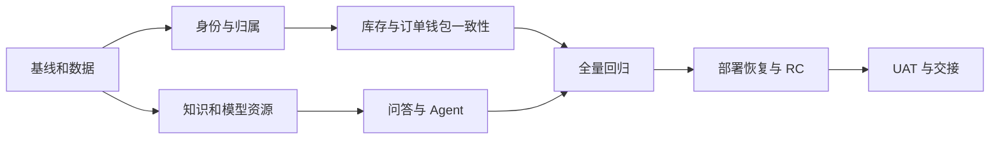

# AgentMall 开发计划书

## 1. 文档目的

本文依据《AgentMall 开发高层设计》[DHD-v1.md](DHD-v1.md)，参照附件 DPD-v1.md 的章节结构，形成 AgentMall 后续完善、联调、质量验证和交付的可执行建议计划。

本计划是对已有项目的反向规划，**不是历史开发记录，也不代表人员已经到岗、预算已经批准或功能已经验收**。已存在的商城与 AI 代码作为输入；工作量主要用于核对、补缺和交付加固，不重复估算从零开发整套商城。

编制基准日期：2026 年 10 月 17 日（America/Los_Angeles）。代码基线 `c483c42`；前端 `0.0.1`，后端 `0.0.1-SNAPSHOT`。

建议周期：T0 起 10 个自然周，按每周 5 个工作日估算，每人 50 个工作日；扣除例会、日常支持及不可预见中断 6 日后，净容量每人 44 人日。T0 为团队、环境及范围确认后的首个工作周周一，具体日历日期、节假日和请假待排期时换算，不套用原模板日期。

建议团队：前端高级 1 人、前端中级 1 人、后端高级兼开发经理 1 人、后端中级 1 人。产品、业务验收与运维由外部协作人员承担；以上均为估算假设，实际人力变化需要重排。

## 2. 项目目标与范围

### 2.1 项目目标

1. 在现有功能上建立可复现的数据库、账号、模型、构建和部署基线。
2. 补齐 ADMIN 管理授权、USER 个人对象归属、密码和密钥响应保护。
3. 形成购物车到下单、钱包记账、发货、收货、评价和取消退款的可验证闭环。
4. 修复库存、订单状态、退款和充值的一致性与并发问题。
5. 验证知识导入、切片、向量、检索和有据问答，明确本地回退能力边界。
6. 完善导购执行的重复提交、异常状态和超时追踪，保留业务工具证据。
7. 验证评价分析与增长报告，准确标注统计口径。
8. 补充必要业务回归、CI 验证、部署恢复证据和交接材料。

### 2.2 开发范围

| 工作域 | 当前输入 | 本期交付目标 |
| --- | --- | --- |
| 身份与权限 | JWT、USER/ADMIN、用户 CRUD | 密码哈希迁移、字段白名单、管理鉴权和归属校验 |
| 商品与内容 | 分类、品牌、商品、详情、参数 | 数据约束、上下架及价格库存变化联调 |
| 用户商城 | 地址、收藏、购物车、钱包和订单页面 | 本人数据闭环、异常反馈与操作防重 |
| 交易一致性 | 下单和取消事务、余额与流水 | 原子库存、状态条件更新、退款和结算幂等、充值事务 |
| 知识/RAG | 导入、180/30 切片、真实/本地向量、检索 | 重建与模型空间校验、失败反馈、效果样本评估 |
| Agent | 10 轮循环、最多 3 条推荐、Run/Step | 运行状态收敛、并发互斥、预算和去重、超时追踪 |
| AI 配置与结果 | 模型、Prompt、工具、问答、分析、报告 | 配置脱敏、运行接线说明、失败与统计口径修正 |
| 文件与文本展示 | 文件服务、Marked | 上传下载边界、HTML 清洗和恶意输入验证 |
| 工程与部署 | Docker、SQL、verify、CI 接收器 | 文档同步、业务测试、迁移方案、备份恢复与发布验证 |

### 2.3 本期不包含

- 微信/支付宝/银行卡等真实支付、支付回调、资金托管与商户结算。
- 退换货工单、逆向物流、部分退款和售后自动赔付。
- 多商户、多租户、商家入驻和跨租户隔离。
- 原生移动应用、物流平台对接、优惠券发放及完整营销规则引擎。
- 分布式 Agent 编排、多实例任务调度和独立向量数据库迁移。
- 基于埋点的完整导购归因、独立 BI 和自定义报表。
- 自动将运行中的服务器升级或实际对外发布；本计划交付可评审候选及发布材料，实际执行沿既有发布流程。

上述事项进入独立变更评估。核心账本和权限整改不因范围压缩被移出本期。

## 3. 计划假设与约束

### 3.1 计划假设

- 四名开发稳定投入，产品负责人一个工作日内答复需求和指标口径问题。
- 第 1 周拿到脱敏数据或可复现种子数据、两名普通用户及管理员测试账号。
- 第 2 周前提供隔离 MySQL、上传存储和联调环境。
- 第 3 周前提供支持 Function Calling 的 CHAT 模型、EMBEDDING 模型及测试额度。
- 第 6 周前提供接近目标环境的预发布服务、域名/证书及备份空间。
- 第 8 周前业务方安排商城运营、普通用户及管理员参加 UAT。
- 没有独立测试岗位；开发交叉测试，业务负责最终验收，运维负责环境与恢复协作。
- 未获得生产规模、访问量和知识量指标；性能数值先作为待校准目标，不能当作现状承诺。

### 3.2 技术约束

- 前端继续 Vue 3 + Vite 5 + Vue Router 4 + Element Plus，保持 SPA 与 History 路由。
- 后端 Java 21 + Spring Boot 3.5.14 + Spring AI 1.1.7 + MyBatis；数据库沿用 MySQL，容器基线为 8.4。
- 使用 UTF-8；Node.js 20 或更高并满足锁文件要求；Maven/npm 以锁定依赖构建。
- 保留现有 GET/POST/PUT/DELETE 协议及 Result 包装，协议变化需显式兼容评审。
- 开发可直连 9090；容器经 Nginx `/api/` 转发，不照搬模板的全 POST 或其他数据库方案。
- 继续使用 OpenAI 兼容模型服务；不把某家模型商、特定密钥或真实模型可用性写成已落实资源。
- 向量暂存 MySQL 并由应用计算相似度；上线容量由压测决定。
- 初始化 SQL 仅用于空库；既有数据库用审查后的显式迁移，不能依靠重建卷升级。
- 当前 `main` push 可触发现有发布工作流；新增开发与文档变更在分支评审，避免无意触发实际上线。

### 3.3 进度约束

身份字段与数据归属先于多角色联调；订单原子性先于并发交易验收；知识数据与模型配置先于 RAG 效果验收；Agent 工具可用先于导购端到端验收；部署恢复验证先于发布候选交付。

第 7 周结束冻结功能范围，第 8 周冻结接口及数据库方案，第 9 周末生成 RC；冻结后只接受阻塞交付的修复，普通优化进入下一期。

## 4. 团队组织与职责

### 4.1 人员角色

| 角色 | 职责 |
| --- | --- |
| FE-S 前端高级 | 页面和请求层架构、导购/问答复杂交互、AI 文本清洗、前端评审及质量 |
| FE-M 前端中级 | 商品、购物车、订单、地址、钱包和后台常规页面、跨端回归 |
| BE-S 后端高级兼开发经理 | 身份权限、交易并发、Agent 状态、技术评审、计划与发布协调 |
| BE-M 后端中级 | 商品/知识/分析服务、数据脚本、接口测试、部署验证和备份恢复配合 |
| 业务/产品协作 | 交易与统计口径、验收数据、UAT 和遗留问题结论，不计入开发人日 |
| 运维协作 | 隔离环境、证书、凭据、备份和发布恢复，不计入开发人日 |

### 4.2 管理职责

开发经理维护范围、依赖、风险和剩余工作量，主持权限、账本、模型和数据迁移评审，确保任务有具体交付及证据。每周更新预计完成周，不以“页面完成”代替业务闭环完成。关键路径阻塞超过 2 个工作日时重排计划并给出影响。

### 4.3 模块主责与备份

| 模块 | 主责 | 备份/评审 |
| --- | --- | --- |
| 路由、请求封装、错误与登录交互 | FE-S | FE-M |
| 商品、购物车、钱包、订单与地址页面 | FE-M | FE-S |
| 导购、问答、运行轨迹与知识页面 | FE-S | FE-M |
| 模型配置、工具、分析及报告页面 | FE-M | FE-S |
| 密码迁移、权限与数据归属 | BE-S | BE-M |
| 订单库存、钱包与幂等 | BE-S | BE-M |
| 商品、评价、知识和检索服务 | BE-M | BE-S |
| Agent 生命周期、模型工具执行 | BE-S | BE-M |
| 分析指标、数据脚本、部署验证 | BE-M | BE-S |
| 交叉回归与交接 | 全员分域负责 | 开发经理统筹 |

关键模块必须由备份人员走查，数据库变更和账本代码须 BE-S 复核。

## 5. 软硬件资源需求

以下为建议配置，需按样本压测和预算确认，并非当前服务器实测配置。

### 5.1 开发人员工作站

每人至少 6 核 CPU、16GB 内存、512GB SSD；推荐 8 核、32GB 内存、1TB SSD。安装 JDK、Maven、Node、Git、Docker/Compose 和 MySQL 客户端，支持浏览器调试及双角色并行登录。远程模型调用不要求本地 GPU。

### 5.2 共享服务器资源

| 资源 | 初始建议 | 用途 |
| --- | --- | --- |
| CI 构建 | 4 vCPU / 8GB / 60GB SSD | 前后端构建、测试、镜像及短期制品 |
| 集成环境 | 4 vCPU / 8GB / 100GB SSD | MySQL、后端、Nginx 和联调 |
| 预发布环境 | 4～8 vCPU / 8～16GB / 150GB SSD | 多角色、并发、模型和部署验证 |
| 备份存储 | 至少有效数据库与上传总量的 2 倍 | 发布前快照、每日备份及恢复演练 |

当前 Compose 对 db/backend 各设 1GB、web 128MB 内存限制，这是仓库配置，不是容量证明。若压测接近容器内存限制或扫描向量导致延迟增长，先测量再调整。镜像发布接收器已有磁盘空间保护，容量计划另预留前版镜像与构建包。

### 5.3 软件资源

统一 JDK 21、Maven 3.9 系列、Node.js 20+、npm、MySQL 8.4、Docker Compose、Nginx、Python 3，以及 Chrome/Edge 当前支持版本。IDE 和 API 客户端按团队习惯选择，不继承模板的 PowerShell、Go、React、SQLite 或 PostgreSQL 限制。

业务测试建议使用现有 Spring Boot Test 依赖补充单元/集成测试，前端先建立关键交互验证与端到端用例；是否引入额外框架在第 1 周确定，避免为工具迁移扩大范围。

### 5.4 外部系统和账号

- 隔离的 CHAT 和 EMBEDDING 模型连接，明确额度、限流、Function Calling 支持及可用窗口。
- 数据库应用账号和迁移账号分离；管理员、普通用户 A/B 与运维验证账号。
- Git 评审权限、CI 构建权限和现有受限发布身份；凭据不进入文档或制品。
- 预发布域名与 HTTPS 证书、备份目录访问能力。
- 可重复导入的商品、库存、余额、订单、评价、售后与知识样本。

### 5.5 协作资源

任务/缺陷看板、接口清单、迁移记录、风险登记、模型评估样本、测试账号登记、发布和回滚检查单。产品每周至少 2 小时确认口径，运维第 6～10 周每周至少 2 小时协作；实际投入需启动时落实。

## 6. 工作量评估

### 6.1 估算口径

1 人日按 8 小时计算；工作包包含设计细化、实现、自测、评审修改及直接文档。专项集成和回归独立计入，不重复累计。数字为建议估算，预期误差约 ±20%；第 1 周完成基线复现后重新估算。

### 6.2 前端工作量

| 编号 | 工作包 | FE-S | FE-M | 合计 | 主要交付 |
| --- | --- | ---: | ---: | ---: | --- |
| FE-01 | 基线、路由/请求、登录和错误规范 | 4 | 2 | 6 | 可构建基线、状态及失败反馈 |
| FE-02 | 商品、资料、地址、收藏 | 3 | 6 | 9 | 个人数据页面及边界交互 |
| FE-03 | 购物车、钱包、订单、评价 | 5 | 8 | 13 | 交易闭环、状态刷新和防重 |
| FE-04 | 知识、切片、向量与进度 | 4 | 4 | 8 | 重建反馈和检索展示 |
| FE-05 | 导购、问答与运行追踪 | 8 | 3 | 11 | 长任务反馈、证据和异常展示 |
| FE-06 | 模型、工具、分析与报告 | 4 | 6 | 10 | 脱敏、配置边界及真实指标口径 |
| FE-07 | HTML 清洗、文件及输入边界 | 3 | 2 | 5 | 安全文本与上传交互 |
| FE-08 | 联调、兼容、回归、UAT 和交接 | 7 | 5 | 12 | 回归记录、候选和操作说明 |
| 合计 |  | **38** | **36** | **74** |  |

### 6.3 后端工作量

| 编号 | 工作包 | BE-S | BE-M | 合计 | 主要交付 |
| --- | --- | ---: | ---: | ---: | --- |
| BE-01 | 基线复现、数据和测试工程 | 2 | 3 | 5 | 可重复初始化、测试账号 |
| BE-02 | 密码、管理权限、归属和响应字段 | 6 | 4 | 10 | 身份迁移与拒绝越权 |
| BE-03 | 商品、评价、地址和数据约束 | 2 | 4 | 6 | 基础服务规则和校验 |
| BE-04 | 库存、订单、钱包、事务及幂等 | 7 | 5 | 12 | 并发交易与账本回归 |
| BE-05 | 知识切片、模型空间和向量重建 | 3 | 5 | 8 | 一致性和检索基线 |
| BE-06 | 模型工具、Agent 生命周期与防重 | 6 | 5 | 11 | 可追溯执行、异常收敛 |
| BE-07 | 分析、指标口径、文件保护 | 2 | 3 | 5 | 报告口径与边界处理 |
| BE-08 | 自动化回归、性能、部署和恢复 | 5 | 10 | 15 | 集成证据、迁移与恢复演练 |
| 合计 |  | **33** | **39** | **72** |  |

### 6.4 项目管理与总工作量

| 类别 | 人日 |
| --- | ---: |
| 前端开发与验证 | 74 |
| 后端开发与验证 | 72 |
| BE-S 计划、协调、评审组织和发布管理 | 7 |
| 承诺工作量 | **153** |
| 净容量：4 人 × 44 人日 | **176** |
| 风险储备 | **23** |

风险储备占净容量约 13.1%，用于数据库与部署差异、模型不稳定、交易缺陷和估算偏差，不用于悄然增加范围。常规个人任务评审已计入各工作包，管理 7 人日仅计跨域组织及协调，避免重复。

### 6.5 人员负载

| 人员 | 承诺人日 | 净容量 | 储备 |
| --- | ---: | ---: | ---: |
| FE-S | 38 | 44 | 6 |
| FE-M | 36 | 44 | 8 |
| BE-S | 40（开发 33 + 管理 7） | 44 | 4 |
| BE-M | 39 | 44 | 5 |
| 合计 | **153** | **176** | **23** |

BE-S 储备最少，应让 BE-M 提前掌握交易与权限实现；任务在周内跨工作包穿插，不将两名后端关键任务全部排在同一时间。

## 7. 开发进度与日期计划

### 7.1 总体进度

以下为相对周计划。T0 到 T0+9 周是 10 个自然周，不将其写成已确认的日历承诺。

| 周次 | 前端重点 | 后端重点 | 周末交付标准 |
| --- | --- | --- | --- |
| W1 | 基线复现、路由请求、页面/接口核对 | SQL、种子、构建、风险复核、测试框架 | 可复现环境，范围/权限矩阵/估算评审 |
| W2 | 登录与角色体验、个人资料和字典 | 密码迁移、DTO、ADMIN/归属校验 | 双 USER + ADMIN 身份和越权用例通过 |
| W3 | 商品、地址、收藏、购物车联调 | 商品约束、购物车、原子库存和余额 | 个人数据隔离与交易接口基础可用 |
| W4 | 订单、钱包、取消、收货、评价 | 下单/退款幂等、条件状态、充值事务 | 交易闭环及并发关键用例通过 |
| W5 | 知识、切片、向量进度与检索 | 模型空间、重建一致性、任务边界 | 知识到检索可复现；模型依赖落实 |
| W6 | 导购/问答、证据、长任务状态 | 工具输入校验、Agent 防重和状态收敛 | 真实模型导购及问答闭环，预发布可用 |
| W7 | 配置、分析、报告、文本清洗 | 统计口径、文件、模型异常补齐 | 范围内功能集成完成，功能冻结 |
| W8 | 交叉回归、兼容、移动端和异常 | 接口全量回归、权限、交易和数据升级 | 接口与结构冻结，阻塞缺陷收敛 |
| W9 | UAT 预演、缺陷修复、操作说明 | 压测、恢复、部署、RC 制品 | 严重缺陷清零，候选与证据齐备 |
| W10 | 业务验收支持、培训和交接 | UAT 修复、最终回归及发布评审材料 | UAT 结论、候选制品和运维交接 |

### 7.2 关键里程碑

| 里程碑 | 时间 | 退出条件 |
| --- | --- | --- |
| M0 基线和计划确认 | W1 末 | 环境可复现，范围和资源明确 |
| M1 身份与隔离 | W2 末 | 密码迁移、角色和归属用例通过 |
| M2 交易闭环 | W4 末 | 下单至评价、取消退款及并发验收通过 |
| M3 AI 闭环 | W6 末 | 知识检索、问答、导购及追踪可用 |
| M4 功能冻结 | W7 末 | 范围内工作可集成，遗留清单明确 |
| M5 接口/结构冻结 | W8 末 | 兼容方案及迁移评审完成 |
| M6 RC | W9 末 | 全量回归、部署恢复及高优缺陷结论完备 |
| M7 验收与交接 | W10 末 | 业务签收、制品和发布检查单齐备 |

### 7.3 关键路径

两条路径均可能成为关键路径。模型账号延迟不阻止普通商城整改，但会推迟真实 AI 验收；模拟模型可验证协议和异常，不能代替真实模型效果结论。

### 7.4 联调安排

W1 建接口清单，W2 起每完成一组接口即提供示例与隔离账号；W4 完成交易专题联调，W6 完成 AI 专题联调。每周三清理接口差异，周五演示与重新估算。W8 之后任何协议与结构变动都要附兼容、迁移和回归影响。

## 8. 开发方法与质量控制

### 8.1 任务管理

任务以 0.5～3 人日拆分，包含负责人、评审人、DHD 章节或 G 编号、输入依赖、输出、异常分支、验收证据及估算。看板分“待开始、进行中、待评审、待联调、完成”；只有通过验证才关闭。

### 8.2 分支与代码评审

独立分支和 PR 评审，权限、账本、状态机、模型工具、迁移和发布脚本由高级人员复核。合并前记录构建与相关回归。现有 main push 可能发布，合并和实际上线须遵循项目既有授权与流程，本计划编制不自动触发。

### 8.3 完成定义

代码、输入校验、权限与归属、正常及主要异常用例、文档和迁移同步完成；评审通过；集成验证有记录；敏感字段无泄露；缺陷及风险有结论。不能用“接口返回 200”代替业务 code、数据库和用户可见结果验收。

### 8.4 测试责任

| 类型 | 负责人 | 关键内容 |
| --- | --- | --- |
| 页面自测与交叉验证 | FE-S / FE-M | 表单、角色、状态、重复点击、超时、Markdown |
| 业务单元及集成测试 | 相应后端，BE-S 评审 | 权限、原子库存、状态、余额流水、向量隔离 |
| API 清单回归 | BE-M 主导 | DHD 附录 A 每条路由，正常/异常/越权 |
| 真实模型评估 | BE-S + FE-S | 工具调用、证据、无资料、预算、错误反馈 |
| 端到端交叉测试 | 全员 | 注册到交易、知识到问答、任务到推荐追踪 |
| 部署与恢复 | BE-M + 运维，BE-S 复核 | 空库、升级、重启、卷持久化、镜像回滚及数据恢复 |
| UAT | 业务代表 | 普通用户与运营管理员的实际任务 |

### 8.5 质量门禁

发布候选必须满足：

- 前端 `npm ci` 后 `npm run build`，后端 `mvn -f springboot/pom.xml clean verify` 成功。
- 不能因当前没有业务测试而把 Maven 成功视为覆盖充分；本期新增关键业务用例并记录实际测试数量和结果。
- DHD 附录 A 每个路由有回归结论，角色及个人对象越权用例全部通过。
- 至少 20 个并发请求争抢最后 1 件库存，成功成交仅 1 次；失败请求不扣余额、不留下成功订单。
- 至少 10 个并发取消同一 PAID 订单，退款只发生 1 次；库存、双方余额和流水一致。
- 注入明细/流水失败，验证事务回滚；充值与流水无部分提交。
- 固定至少 30 条人工标注的商品问答（含至少 10 条资料未覆盖），记录证据命中、无据拒答和人工正确率。无资料样本均不伪造依据；有资料回答正确率暂定 ≥90%，W1 与业务确认后冻结。
- 导购结果最多 3 条、无重复、满足已确认预算规则，价格和库存可反查；模型错误和长请求状态可追踪。
- 上传、恶意 HTML、危险链接和用户实体/模型密钥输出边界通过。
- 严重及高优先级缺陷为 0，其余有负责人和处理结论。
- 目标 MySQL/容器环境完成部署、重启持久化、升级及恢复演练。

性能建议目标（待 W1 确认）：普通列表查询在 20 并发、约 1000 商品/10000 订单测试集下 P95 ≤1 秒；检索在约 10000 切片下 P95 ≤2 秒。测试记录硬件、数据量、冷热状态、向量维度与外部调用；真实 AI 延迟独立记录，不纳入普通查询指标。容量不达标时调整方案或范围，不能直接删除不利样本。

## 9. 主要交付物

### 9.1 代码与制品

前后端源码与锁文件；后端 JAR、前端 dist、带版本/提交号的镜像；初始化脚本与明确升级脚本；自动化测试和结果；模型评估样本；部署配置和验证脚本。所有制品不包含运行密钥、用户密码和生产数据。

### 9.2 文档

DHD/DPD 评审版、接口回归登记、权限矩阵、数据库变更说明、模型配置与向量重建说明、指标口径、用户/管理员操作说明、部署/备份/恢复/回滚说明、UAT 记录、缺陷及风险移交清单。

README 要同步实际已有的 deploy/initdb、Docker 和 CI 测试，避免继续宣称完全不存在数据库脚本、容器或自动化测试。业务测试、部署测试、构建验证需分别描述。

## 10. 风险管理

### 10.1 风险清单

| 风险 | 影响 | 对策 | 责任 | 对应设计 |
| --- | --- | --- | --- | --- |
| 管理/归属授权不完整 | 非授权读写个人或管理数据 | W2 优先实现，双 USER 越权矩阵 | BE-S | G-01 |
| 密码及配置响应含敏感字段 | 账号、模型连接暴露 | 哈希迁移、DTO 和密钥脱敏 | BE-S | G-02 |
| 并发超卖、重复退款 | 资金与库存不一致 | 原子 SQL、条件状态、幂等与并发测试 | BE-S | G-03 |
| 充值部分提交 | 余额流水不一致 | 事务和故障注入 | BE-M | G-04 |
| 模型不支持工具/额度不足 | 导购或评估阻塞 | W3 前试通、准备兼容备用模型 | BE-S | G-05 |
| Agent 超时、重复执行、状态不一致 | 用户误重试或无法追踪 | 防重、状态收敛、查询及明确反馈 | BE-S/FE-S | G-05 |
| 向量后台进度重启丢失 | 任务中断、结果不完整 | 明确恢复方式、失败与进度验证 | BE-M | G-06 |
| 模型混用与线性扫描 | 检索错误、性能不足 | 模型版本校验、重建、容量测量 | BE-M | G-07 |
| AI 文本/文件输入不受控 | 恶意内容执行或文件滥用 | 清洗、类型和路径边界 | FE-S/BE-M | G-08 |
| 指标被误读为真实转化 | 业务决策失真 | 全量口径和数量比值标注 | FE-M/BE-M | G-09 |
| README 与部署实现不一致 | 新环境不可复现 | 以源码更新文档并复测 | BE-M | G-10 |
| 人力或环境未落实 | 关键路径延期 | W1 重估，使用储备并显式调整交付周 | 开发经理 | 计划假设 |

### 10.2 风险触发条件

任一关键依赖超过 2 个工作日未落实；W4 交易并发未通过；W6 真实模型闭环不可用；W8 仍存在高优先级权限/账本缺陷；备份不可恢复；预计剩余人日超过剩余容量。触发后当天登记，1 个工作日内提出延期、资源或范围调整方案。

### 10.3 进度压缩顺序

先延后视觉润色、非关键筛选和额外报告展示，再减少非核心调试增强；随后延后复杂任务持久化编排（保留清晰的单实例限制与恢复策略）。授权隔离、密码与密钥保护、账本一致性、核心模型真实验证、数据恢复不压缩。压缩后仍不满足门禁则调整候选日期。

## 11. 变更控制

新增需求登记背景、业务价值、涉及设计与接口、工作量、依赖、验证及迁移影响；开发经理组织评估，产品确认优先级并选择替换等量范围、增加资源或顺延周期。更新 DHD、DPD 和里程碑后进入迭代。

引入真实支付、售后工单、多商户、向量数据库或分布式调度均属于重大范围变化，不能作为“顺手完善”计入储备。授权和账本规则修正属于本期已知工作，按现有包执行。

## 12. 沟通与报告机制

### 12.1 例会

每日短会聚焦阻塞和依赖；每周三接口/数据问题清理；周五演示、缺陷和风险评审；W4、W6、W9 进行交易、AI 和发布专题评审。此处为建议会议安排，未自动创建会议或发送消息。

### 12.2 进度报告

周报记录本周验收工作包、证据链接、剩余人日、关键缺陷、依赖、下周目标、预计里程碑及风险储备消耗。已编码、已联调、已验收分别记录；AI 结果附模型版本和样本口径。

### 12.3 问题升级

权限、资金、数据损坏等阻塞当天告知负责人；模型资源、环境或需求歧义超过一个工作日未解决时升级给产品/运维协作人。所有结论落到缺陷或决策记录，防止只存在聊天中。

## 13. 验收与发布条件

### 13.1 开发验收

DHD 范围与路由完成核对；构建、业务测试和必要性能用例通过；G-01～G-10 有实现或明确受限结论，发布阻塞项不得仅以“已知风险”关闭；迁移、密钥脱敏、数据恢复和依赖锁定材料齐备。

### 13.2 业务验收

| 场景 | 必须可观察的结果 |
| --- | --- |
| 注册/登录与个人资料 | USER 只操作本人信息；ADMIN 管理边界清楚 |
| 商品到评价 | 浏览、加购、内部余额结算、发货、收货、评价完整，金额及库存正确 |
| 取消退款 | PAID 才能取消，资金和库存只退一次，双方流水一致 |
| 知识问答 | 已覆盖问题有正确证据；未覆盖问题如实说明；价格订单走实时业务数据 |
| 智能导购 | 提交需求和预算，得到可购买商品、理由、证据及 Run/Step；失败能定位 |
| 评价分析/增长报告 | 数据与样本可追溯，统计口径准确，建议与事实区分 |
| 运维恢复 | 重启后数据文件保留；旧镜像可回滚；数据库备份可恢复 |

UAT 使用隔离钱包及账号，不将演示充值和管理员收款视为真实支付能力验收。

### 13.3 发布条件

候选制品可追溯到提交；质量门禁通过；版本说明和遗留清单明确；环境变量、模型凭据和 HTTPS 按目标环境确认；完成发布前备份、数据库迁移评审及恢复验证；保留旧镜像和数据恢复路径；业务及运维完成交接。

现有 `verify.py` 仅验证登录、商品查询、文件和重启持久化，不能替代交易/AI 回归；现有 CI 自动回滚主要针对应用镜像，数据库结构不能靠镜像回滚恢复。

## 14. 发布后安排

建议发布后 5 个工作日安排缺陷响应，首日重点观察登录失败、订单金额和库存、模型异常、Agent 卡住、文件错误及磁盘增长。按实际业务节奏复核账本与流水、失败任务、模型费用与检索质量。记录每项异常的负责人和处理结果；稳定后移交维护。

下期候选包括真实支付、完整售后、可靠任务队列、向量索引和导购归因，均需新的业务依据和专项评估，不视为本期已承诺功能。

## 附录 A. 计划与设计追踪

| 设计问题 | 主要工作包 | 验收里程碑 |
| --- | --- | --- |
| G-01、G-02 权限与账号 | BE-02、FE-01/02/06 | M1 |
| G-03、G-04 交易与账本 | BE-04、FE-03 | M2 |
| G-05 导购状态和防重 | BE-06、FE-05 | M3 |
| G-06、G-07 知识任务与模型空间 | BE-05、FE-04 | M3，容量在 M6 验收 |
| G-08 文本和文件 | FE-07、BE-07 | M4 |
| G-09 指标口径 | FE-06、BE-07 | M4 |
| G-10 文档与部署基线 | BE-01/08、FE-08 | M0 / M6 / M7 |

依据文件为同目录 DHD-v1.md 及其中附录 C 的源码索引；工作量、资源、团队、性能和工期均为本计划的建议假设。
